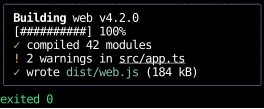
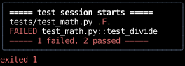

# One-Shot Commands

A one-shot command runs a program that's expected to exit, though not necessarily to succeed,
and shows everything it printed, colors and all, as a terminal would have shown it.
A slide can run an example command when it's shown,
and an editor can run the code in a text area and show what it printed.

This page covers running a command, how its output is sized,
the terminal it runs on, cancelling and timing out a run, and showing output recorded ahead of time.

## Running a command

[`use_command`][counterweight.commands.use_command] runs a program when its `run` is called,
and returns the latest run, a [`CommandRun`][counterweight.commands.CommandRun] value
holding the program's `argv`, everything it printed so far as `output`, and its `outcome`.
[`command_output`][counterweight.commands.command_output] shows a run:
its output in a [`scroll_area`](../headless/use_scroll_area.md#a-styled-scroll-area)
that sticks to its end, so it follows the output while the program runs,
with a line beneath that says how the run is going, or how it ended.

A slide that runs its command when it's shown calls `run` from an effect:

<!-- example: commands.py:slide -->

=== "A run that succeeded"

    

=== "A run that failed"

    

A code runner runs its code on a key press instead:

<!-- example: commands.py:runner -->

This follows React Query's hooks for a `fetch`.
`useMutation` runs on an event, through its `mutate()`, and exposes the latest run's status and result,
which is `run` and `latest` here,
and `useQuery` runs when its component mounts and again when its key changes, which is the slide's effect.
A run differs from a `fetch` in two ways:
its output streams, so `latest` shows what the program has printed so far while it runs,
updating at most once a frame,
and a program that exits with a failing status is a result like any other, not an error.

A run is a value that outlives its program, so a component can keep finished runs in state,
show one again, or show it beside the next.
Calling `run` again starts another run, even with the same `argv`, and hangs up the run in progress.

## How a run is sized

A run has two sizes, and only the first comes from its box.

- **The terminal's size** is what the program formats its output for (wrapping, tables, progress bars).
  Its width is `use_command`'s `columns`, which the slide and the runner read from the box their output is shown in,
  by passing `command_output` the same `viewport` handle they measure with
  [`use_rects(viewport)`](../hooks/use_rects.md#measuring-another-element).
  It's read when the run starts, and a run waits to start until it's positive,
  since `use_rects` reports zero on the first render.
  A later change doesn't rewrap a run's output: columns past the box's edge are cut off,
  and running again at the new width is up to the caller.
  Its height is `rows`, 24 by default, as a fresh xterm's is,
  which a program drawing a live display sizes it to.
  It doesn't come from the box, since the box scrolls rather than being the program's screen.
- **The output's size** is how much the program printed: the run's `columns` wide,
  and as tall as the lines it printed, which grow while it runs.
  Its canvas takes that height, and the scroll area shows as many lines as fit.

!!! warning "Size the box from its parent"

    The output's width is the run's `columns`, which comes from the box,
    so the box has to take its width from its parent, by stretching, `fill`, or a styled width.
    A box sized by its content stays zero wide, and its run never starts.

## The terminal it runs on

A run gets a pseudo-terminal rather than pipes, so it prints what it would in a terminal:

- **Colors.** Most programs color their output only when their output is a terminal.
- **Cursor movement.** A progress bar that rewrites its line with `\r`, or a live display that moves the cursor up
  and redraws, leaves its last frame in the output, rather than every frame run together.

Its standard output and standard error arrive together, as they do in a terminal.
A program that has to tell them apart is better run with `asyncio`'s subprocess functions,
which need no terminal.

The program sees a terminal, so it acts as it would on one:

- Its standard input is `/dev/null`, so a program that reads input gets end of file rather than waiting for keys.
  A program that has to talk to its terminal can still open `/dev/tty`.
- `PAGER` and `GIT_PAGER` are `cat`, so `git log` and other commands that start a pager print instead.
  Other tools read their own variables, such as `MANPAGER`, which `env` can set.
- A program that asks its terminal something, such as where its cursor is, gets an answer from the emulator.
- Its environment is the app's, under the terminal's variables (`TERM=xterm-256color`, `COLORTERM=truecolor`)
  and the pager defaults, under `env`, as for [`run_pty`][counterweight.pseudoterminal.run_pty].
  `clear_env=True` leaves out the app's, which keeps a run's output from depending on who runs it.

## Cancelling and timing out

`cancel` hangs up the run in progress and makes its outcome
[`Cancelled`][counterweight.commands.Cancelled], keeping what it printed.
Starting another run and unmounting the component hang it up too.
Hanging up sends the program's process group `SIGHUP`, as closing a terminal window does,
and `SIGTERM` and then `SIGKILL` to whatever is still running a second apart,
so nothing a run started outlives it.
That goes on in the background, so a program slow to exit doesn't hold up the app,
which waits for it when it stops
(see [Hanging up in the background](emulators.md#hanging-up-in-the-background)).

A program never gets the keys the app reads, so it can't be interrupted with Ctrl+C:
bind a key to `cancel`, as the runner does with Escape.
Ctrl+C [reaches the app as a key press](../input-handling/events.md#keys-the-terminal-would-act-on),
so an app can bind it to `cancel`, as a shell does, rather than leaving it to quit the app.
`timeout` bounds a run: a program still running when it runs out is hung up,
and its outcome is [`TimedOut`][counterweight.programs.TimedOut].
Only the program's own run counts against it: one that exits in time has exited,
even if a background job it left keeps its terminal open past the timeout.

A run keeps the last `max_lines` lines of its output, 10,000 by default, dropping the oldest,
so a program that never stops printing can't grow it without bound.

## Recorded output

[`Transcript.of`][counterweight.painters.terminal.Transcript.of] turns output recorded ahead of time,
such as with `script`, into the same output a run has, with no program run,
so a slide can show a command's output without running it.
That's how the screenshots on this page were drawn:

<!-- example: commands.py:recorded -->

A [`Transcript`][counterweight.painters.terminal.Transcript] is a [`Canvas`](../elements/canvas.md) painter,
so a canvas can show it without `command_output`.

## API

::: counterweight.commands.use_command
::: counterweight.commands.Command
::: counterweight.commands.CommandRun
::: counterweight.commands.Outcome
::: counterweight.commands.Cancelled
::: counterweight.commands.command_output
::: counterweight.commands.CommandOutputStyles
::: counterweight.commands.COMMAND_ENVIRONMENT
::: counterweight.painters.terminal.Transcript
