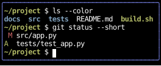

# Embedded Terminals

An embedded terminal runs an interactive program, such as a shell, an editor or `htop`, in a box,
shows its screen as the program draws it, and sends it the keys, pastes and mouse events the box receives,
as a terminal window or a multiplexer's pane does.
It's enough to build a terminal multiplexer: the [multiplexer](https://github.com/JoshKarpel/counterweight/blob/main/examples/multiplexer.py)
example runs shells side by side, with a tmux-style prefix key.

This page covers the widget, the hook it's built on, a multiplexer built from it, how input reaches the program,
and how the terminal is sized.
For a program that's expected to exit, whose output is read rather than used, see [One-Shot Commands](commands.md).
Pseudo-terminals need Linux or macOS.

## A terminal widget

[`terminal`][counterweight.widgets.terminal] is a bordered box that runs a program in a terminal the size of its content:

<!-- example: terminals.py:widget -->

The screenshot feeds shell output written ahead of time to an emulator rather than running a shell,
so it comes out the same on every run.

The box takes no size from the program, since the program draws whatever fits the terminal it's given,
so size the box with `style`, as `fill(1)` does here.
The program starts once the box has room, and its terminal resizes with the box.

While the box is focused, the program gets every key, Ctrl+C and Ctrl+Z included,
so an app that embeds a terminal needs some other way out.
`intercept` is a handler that sees each event before the terminal does,
and keeps it from the program by claiming it, as `quit_on_ctrl_q` does for Ctrl+Q.

## The hook

[`use_terminal`][counterweight.headless.use_terminal] runs the program, emulates its terminal,
and makes the calling component focusable, leaving how it's drawn to the component,
which returns a [`Canvas`](../elements/canvas.md) with the hook's `view` and `on_input`.
This pane puts a prefix handler before the terminal's, as the multiplexer does:

<!-- example: terminals.py:pane -->

The hook returns the program's [`Screen`][counterweight.emulator.Screen] as of the last snapshot,
with its title and the modes it set, and its `status`: starting, running, exited with its status,
or the reason it failed to start.
The component's `view` is a [`ScreenView`][counterweight.painters.terminal.ScreenView]
that draws the cursor while the component is focused.

## A multiplexer

Panes like that one, side by side, with a prefix key that moves focus between them, make a multiplexer.
This recording is laid out like the multiplexer example,
with Ctrl+B and then o moving focus from a shell running pytest to `top` and back:

<!-- cast: terminals-multiplexer -->

Notice that only the focused pane draws its cursor and lights its border,
that each pane's title is the title its program set, from its `Screen`,
and that the bar along the bottom lights up while the prefix waits for its key.
The panes replay output written ahead of time rather than running a shell and `top`,
since a real program's output isn't the same on every run
(see [Replaying recorded output](emulators.md#replaying-recorded-output)),
so the keys in the recording move focus but reach neither program.

## Input

Keys, pastes and mouse events reach the program re-encoded, as tmux sends them, rather than passed through,
since the app has already parsed the bytes its terminal sent into events.
Each is encoded as xterm sends it, since the program is told `TERM=xterm-256color`,
and for the modes the program set:

- **Keys** go to the program while the component is focused and the program is running,
  and are claimed, so they don't bubble.
  Cursor keys switch to their application form (`ESC O A`) for a program that set DECCKM, as vim does.
- **Pastes** are wrapped in bracketed paste's markers for a program that set `?2004`,
  with any end marker in the text removed, so a paste can't end itself early.
- **Mouse events** on the program's screen go to it only if it asked for them, at the level it asked for:
  presses, releases and the wheel, motion while a button is held, or all motion.
  A press focuses the component wherever it lands, and one on the border or padding only focuses it.
  Once the terminal has claimed a press, the drag and release that follow come to it wherever the pointer goes,
  and are clamped to the screen's edges.
  A wheel the program didn't ask for passes on, so a scroll container around the terminal still scrolls.
- **Focus events**, `ESC [ I` and `ESC [ O`, go to a program that set `?1004` as the component gains and loses focus.

Once the program has exited, keys and pastes pass on, so the app's own keys work again.

### Keys before the program

A handler put before the terminal's with [`first`][counterweight.handlers.first] sees each key first,
as a multiplexer's prefix key does:
it claims the keys it binds, and passes on the rest to the program.
The DOM would intercept with a capture-phase listener on an ancestor,
but composing handlers on the terminal's own element does the same.
A prefix and its key often arrive in one read, so keep whether the prefix is waiting in a ref,
as the [Prefix Keys](../cookbook/prefix-keys.md) cookbook page does.

### Queries

Programs ask their terminal things, such as where the cursor is or what kind of terminal it is,
and wait for the answer.
The emulator answers from its own state, as tmux does, and the answer goes to the program as its input.

## Output and size

The emulator is fed as the program writes, and snapshotted at most once a frame,
so a program that writes as fast as it can (`cat` of a large file) costs one snapshot a frame.
When the app falls behind, the pseudo-terminal's buffer fills and the program waits,
which is the backpressure a terminal gives.

A component that sizes the terminal from its own box, with `use_rects().content`, resizes the program's terminal along with it,
which sends the program `SIGWINCH`.
`use_rects` reports the box as of the last frame, so for one frame after a resize the old screen shows,
cropped or padded, until the program redraws, as in tmux.

A program's colors reach the app's terminal as the program chose them (see [Colors](emulators.md#colors)).

## API

::: counterweight.widgets.terminal
::: counterweight.widgets.TerminalStyles
::: counterweight.headless.use_terminal
::: counterweight.headless.EmbeddedTerminal
::: counterweight.input_encoding.encode_key
::: counterweight.input_encoding.encode_paste
::: counterweight.input_encoding.encode_mouse
::: counterweight.input_encoding.encode_focus
