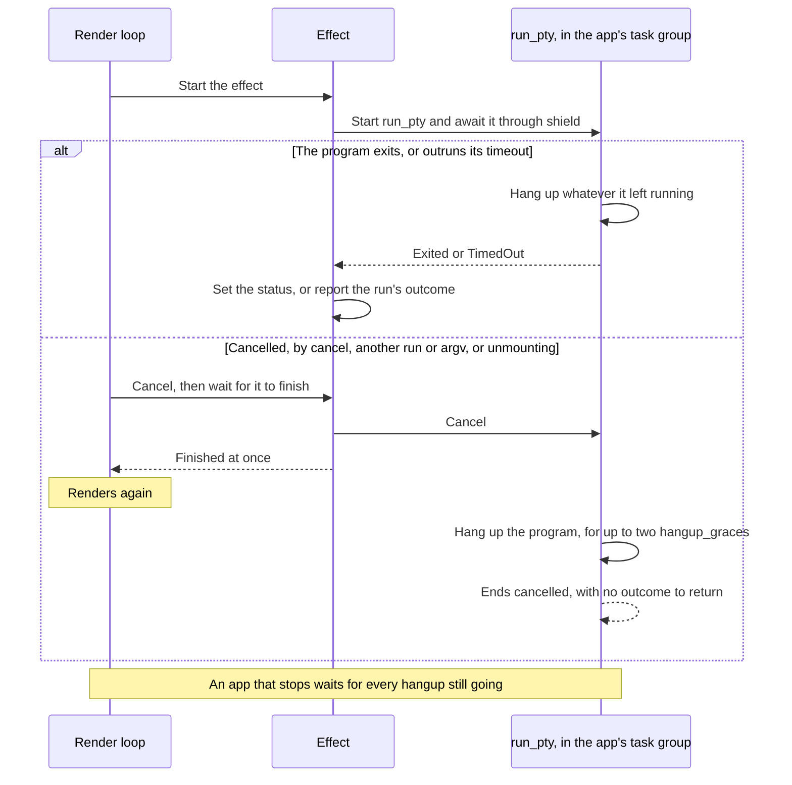
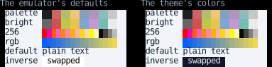

# Emulators and Pseudo-Terminals

[One-shot commands](commands.md) and [embedded terminals](embedding.md) are built from two lower layers,
which this page covers for code that needs them directly:
a pseudo-terminal, which runs a program as a terminal window does and hands back the bytes it writes,
and a terminal emulator, which turns those bytes into what the terminal shows.
Neither knows about the other, so output recorded ahead of time can be fed to an emulator with no program run,
and a program's output can go somewhere other than an emulator.

Pseudo-terminals need Linux or macOS.

## Pseudo-terminals

[`run_pty`][counterweight.pseudoterminal.run_pty] runs a program on a new pseudo-terminal until it exits,
in its own session with the terminal as its controlling terminal,
calling `on_output` with what the program writes, standard output and standard error together.
It returns how the program exited ([`Exited`][counterweight.programs.Exited]),
why it couldn't start ([`FailedToStart`][counterweight.programs.FailedToStart]),
or that it outran its `timeout` ([`TimedOut`][counterweight.programs.TimedOut]),
and hands out a [`PtyConnection`][counterweight.pseudoterminal.PtyConnection] that writes to the program
without blocking and resizes its terminal.
Cancelling it hangs the program up, as closing a terminal window does.

[`use_pty`][counterweight.pseudoterminal.use_pty] runs a program while its component is mounted,
as a terminal window or a multiplexer's pane does:
it starts once its size is positive, resizes the terminal as its size changes,
and starts the program again when its `argv` or environment change.
It hangs the program up in the background, so a program slow to exit doesn't hold up the app's rendering.

### Hanging up in the background

The render loop waits for a cancelled effect to finish before it renders again,
and hanging up a program that ignores `SIGHUP` takes up to two `hangup_grace`s.
So `use_pty`, and [`use_command`](commands.md) for each run, call `run_pty` in a task of the app's task group
and await that task through `asyncio.shield`, which keeps their effect's cancellation from waiting for it:

A program that ends by itself returns its outcome through the effect as usual,
but only once `run_pty` has hung up what it left running.
Only that effect waits for it, not the render loop,
but a program that exits leaving a background job that ignores `SIGHUP` reads as running until that job is gone.
A cancelled run has no outcome to return:
`cancel` has already made it `Cancelled`, and another run or `argv` reports its own.

## Emulators

An [`Emulator`][counterweight.emulator.Emulator] is fed the bytes a program writes,
answers the program's queries through `on_reply`,
and [`snapshot`][counterweight.emulator.Emulator.snapshot] turns what its terminal shows
into an immutable [`Screen`][counterweight.emulator.Screen].
A snapshot of a terminal that didn't change is the same `Screen` as before,
and rows that didn't change are shared between snapshots, so a canvas drawing one redraws only when it changed.
[`scrolled_off`][counterweight.emulator.Emulator.scrolled_off] returns the rows that scrolled off the top of the screen
since it was last called, for an emulator given a `scrollback`.

[`ScreenView`][counterweight.painters.ScreenView] is the [`Canvas`](../elements/canvas.md) painter
that draws a `Screen`, with its cursor when asked,
and [`Transcript`][counterweight.painters.Transcript] the one that draws
everything a program printed.

### Replaying recorded output

An emulator needs no program, only bytes, so output recorded ahead of time replays into one.
Feeding it in the chunks the program wrote, with a snapshot after each,
gives the screens the program showed, which a component reading the [clock](../hooks/use_clock.md) shows in turn:

<!-- example: emulator_replay.py:replay -->

Snapshots are values, so the screens are taken once, the first time they're needed, rather than in every render,
and the component only picks the latest one whose time has come.
This recording replays output in the style of vim's, written by hand rather than recorded from vim,
as it opens a line, types into it, and saves:

<!-- cast: emulator-replay -->

Notice that the emulator applies the cursor movement, colors and alternate screen in the output,
so the replay shows the editor's screen rather than the bytes that draw it.
The [embedded terminals](embedding.md#a-terminal-widget) and [one-shot commands](commands.md#running-a-command) pages
replay output the same way for their screenshots and recordings, since a real program's output isn't the same on every run.

### Colors

A program's colors reach the app's terminal as the program chose them, so they follow the user's theme as they would
had the program run there:
a palette color (`ESC [ 31 m`, or `ESC [ 38 ; 5 ; n m`) stays an [`IndexedColor`][counterweight.styles.IndexedColor],
and an RGB color a `Color`.
A palette entry the program changed (with OSC 4) is the RGB color it changed it to,
since the user's terminal doesn't know it.

A cell in the program's default colors leaves them unset, so it follows the `text_style` of the canvas showing it.
To have those follow the user's theme too, give the canvas the terminal's default colors,
as `text_terminal_default | text_bg_terminal_default | content_terminal_default`
(see [Terminal colors](../styles/utilities.md#terminal-colors)).
A cell whose colors the program swapped (inverse video) or hid (invisible text) has to name its default colors,
so it takes the emulator's `foreground` and `background` instead, which are white and black unless the program
changes them (with OSC 10 and 11).
`set_default_colors` changes them on a running emulator, as the user changing their terminal's theme does,
though a color the program set stays what it set.

Here the same output, with palette, 256-color and RGB backgrounds, plain text and inverse video,
is shown on a light theme twice: once from an emulator left at its defaults, and once from one given the theme's colors:

<!-- example: emulator_replay.py:colors -->

The palette, 256-color and RGB rows and the plain text match, since none of them names a default color.
Only the inverse cell differs: on the left it swaps the emulator's white and black,
which reads as no swap at all on a light theme, and on the right it swaps the theme's colors.

## API

::: counterweight.pseudoterminal.run_pty
::: counterweight.pseudoterminal.PtyConnection
::: counterweight.pseudoterminal.StandardInput
::: counterweight.pseudoterminal.use_pty
::: counterweight.pseudoterminal.Pty
::: counterweight.pseudoterminal.PtyStatus
::: counterweight.pseudoterminal.Starting
::: counterweight.pseudoterminal.Running
::: counterweight.emulator.Emulator
::: counterweight.emulator.Screen
::: counterweight.emulator.Modes
::: counterweight.emulator.MouseTracking
::: counterweight.emulator.MAX_SCROLLBACK
::: counterweight.painters.ScreenView
