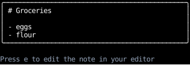
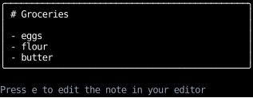
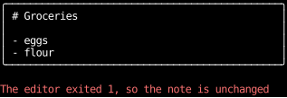

# Running Programs on the App's Terminal

An app can hand its terminal to another program, such as a pager or the user's editor,
and take it back when the program exits,
as `git log` hands the terminal to `less` and `git commit` hands it to an editor.
The program draws on the whole terminal and reads every key while it runs,
and the app learns how it exited.

This page covers running a program, editing a file or text in the user's editor,
what the program gets while it runs, and writing a suspension of your own.
To show a program's output inside the app's UI instead, see [One-Shot Commands](commands.md).

## Running a program

[`Suspend.to_program`][counterweight.controls.Suspend.to_program] is a control that
[suspends](../input-handling/controls.md) the app, runs a program until it exits,
and then calls `on_exit` with how it ended before the app takes the terminal back and redraws.
A log viewer that pages through `git log` on a key press passes its state setter as `on_exit`:

<!-- example: programs.py:pager -->

The outcome is an [`Exited`][counterweight.programs.Exited] with the program's exit status,
or a [`FailedToStart`][counterweight.programs.FailedToStart] with the reason the operating system gave,
such as for a program that isn't installed.
`on_exit` runs before the app takes the terminal back, so a state setter's change shows in the app's first frame.

This is how [Bubble Tea](https://github.com/charmbracelet/bubbletea)'s `ExecProcess` works:
a command that releases the terminal, runs the program on the app's own input and output,
and calls back once it exits.
Bubble Tea sends the program's standard error to the process's,
where counterweight sends it to the app's terminal with the rest of what the program shows.

## Editing a file in the user's editor

[`Suspend.to_edit_file`][counterweight.controls.Suspend.to_edit_file] opens a file in the user's editor,
and calls `on_exit` with how the editor exited.
The file holds the result, so a component showing it reads it again:

<!-- example: programs.py:file -->

An editor that exits with a failing status, as vim's `:cq` makes it, says the user abandoned the edit,
but whatever it saved before then stays saved, so the component reloads after any exit.

The editor is the user's [`preferred_editor`][counterweight.programs.preferred_editor],
found as git finds it: `$VISUAL`, then `$EDITOR`, then `vi`,
with the variable split into words as a shell splits it, so `EDITOR="code --wait"` works.
Pass `editor` to use another one.

## Editing text in the user's editor

[`Suspend.to_edit_text`][counterweight.controls.Suspend.to_edit_text] edits a string in the user's editor,
as `git commit` edits a commit message:
it writes the text to a file in a new temporary directory, edits the file as `to_edit_file` does,
and calls `on_edit` with the text the editor left there.
A note that the user edits in their editor on a key press, or in the `editor` it's given:

<!-- example: programs.py:editor -->

The outcome is an [`Edited`][counterweight.programs.Edited] with the new text,
or, if the edit failed, the editor's `Exited` or `FailedToStart`.
An editor that exits with a failing status abandons the edit, as git treats it,
so `:cq` leaves the text as it was.
These screenshots press e with a shell script as the `editor`, rather than a person in an editor:
one that adds butter to the list and exits successfully, and one that exits with status 1, as `:cq` does:

=== "Before"

    

=== "After an edit"

    

=== "After an abandoned edit"

    

The file name sets the editor's syntax highlighting, so `note.md` edits as Markdown.
Many editors end a file they save with a line break, so the edited text ends with one too.

## What the program gets

- **The app's terminal.**
  The program reads from the app's `input_stream` and writes to its `output_stream`,
  standard error included, rather than to the process's standard streams.
  An app that draws on `/dev/tty` while its standard output is a pipe,
  as a picker run in `vim $(picker)` does, hands the editor the terminal, not the pipe.
  The app hands the terminal back as a suspension does, restoring the terminal's modes, its title,
  and the screen the app started on, so the program starts from a terminal like the one the shell gave the app.
- **The app's environment**, with `env` over it, or only `env` with `clear_env`, and the working directory `cwd`.
  Unlike a one-shot command, it gets no `TERM` of the app's choosing, since it runs on the real terminal.
- **Ctrl+C and Ctrl+\\.**
  The terminal sends `SIGINT` and `SIGQUIT` to the app as well as the program, since they share the terminal.
  While the program runs, the app swallows them, as POSIX's `system()` does, so they don't quit the app,
  and the program handles them as it would in a shell.
  A `SIGINT` sent to the app from outside (`kill -INT`) is swallowed too.
- **Ctrl+Z.** The program, the app, and whatever started the app stop together,
  as a pipeline stops in a shell, and the shell's `fg` resumes them all.

When the program exits, the app takes the terminal again and lays out at the terminal's size,
so resizing the terminal while the program runs is fine.

## A suspension of your own

A [`Suspend`][counterweight.controls.Suspend]'s handler receives the terminal the app handed back,
as [`TerminalStreams`][counterweight.programs.TerminalStreams].
[`run_program`][counterweight.programs.run_program], [`edit_file`][counterweight.programs.edit_file]
and [`edit_text`][counterweight.programs.edit_text] are the functions the controls above run, so a handler can run several programs in turn,
or edit text and then run a program on the result.
The app takes the terminal back as soon as the handler returns, which hides what the programs printed,
so a handler that runs the tests waits for Enter before it returns, as ranger and lf do after a shell command:

<!-- example: programs.py:own -->

The app swallows Ctrl+C only while `run_program` runs,
so an interrupt that arrives while the handler is doing anything else quits the app,
as it does during any suspension.

## API

::: counterweight.programs.TerminalStreams
::: counterweight.programs.run_program
::: counterweight.programs.ProgramOutcome
::: counterweight.programs.Exited
::: counterweight.programs.FailedToStart
::: counterweight.programs.TimedOut
::: counterweight.programs.edit_file
::: counterweight.programs.edit_text
::: counterweight.programs.EditOutcome
::: counterweight.programs.Edited
::: counterweight.programs.preferred_editor
