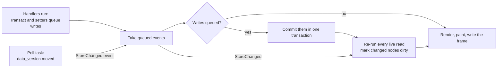

# Plan: Durable State

Artifact: https://claude.ai/code/artifact/f6f4875a-c625-429a-bf99-a49c18a35ded

This plan adds component state that lives in a SQLite file the app owns,
so the process holds a cache of that state rather than its only copy
([#464](https://github.com/JoshKarpel/counterweight/issues/464)).
It adds a `Store` that `app()` opens, two hooks that read from it,
`use_durable(read, deps)` for any query and `use_durable_state(key, default, codec)` for one value under a name,
a `Transact` control that writes to it, and functions an app cleans up stored state with.
It ends with an example app that resumes where it left off, and a benchmark of what a write costs a frame.
It doesn't cover reads on a thread, invalidation finer than "any write re-runs every read",
a migration framework, or syncing a store between machines (see [Future work](#future-work)).

## The question

A counterweight app's state lives in `use_state`, so quitting, a crash, or an upgrade loses
the half-written draft, the open tab, and the scroll position.
How does a component keep what it needs to redraw in SQLite,
read it there on every launch, and see another instance's changes,
without the app keeping its own copy in sync with the component tree by hand?

## How the web does it

| Web | What it does | Here |
| --- | --- | --- |
| [`useSyncExternalStore(subscribe, getSnapshot)`](https://react.dev/reference/react/useSyncExternalStore) | Reads an outside store during render; `getSnapshot` must return a cached value until the store changes, and `subscribe` tells React when it has | `use_durable` reads during render and caches the result on its hook; the render loop is the subscriber, told by commits and by polling |
| [`localStorage`](https://developer.mozilla.org/en-US/docs/Web/API/Window/localStorage) | A synchronous key-value store that outlives the page | `use_durable_state`, over a table counterweight owns |
| [The `storage` event](https://developer.mozilla.org/en-US/docs/Web/API/Window/storage_event) | Fires in _other_ tabs when one changes `localStorage`, never in the tab that wrote | `PRAGMA data_version`, which moves only for the _other_ connections (measured below) |
| [TanStack Query's mutations and `invalidateQueries`](https://tanstack.com/query/latest/docs/framework/react/guides/invalidations-from-mutations) | A write, then re-fetching the queries it made stale | `Transact`, then re-running every live read, the coarsest invalidation |

Two differences change the design.
A browser's storage is synchronous and in memory, where a SQLite read is a call into a file;
measured below, a keyed read takes about 2 µs, cheap enough to run on the event loop.
And React re-renders a subscriber on its own schedule, where counterweight's render loop
decides once per pass what's dirty, so the loop, not the store, re-runs reads and marks nodes.

## What SQLite gives us

A probe against Python 3.15.0 and SQLite 3.53.1, on the dev VM:

```text
['__subclasshook__', 'set_authorizer', 'set_progress_handler', 'set_trace_callback']
before 2 2
after a writes 2 3
query_only: OperationalError('attempt to write a readonly database')
NORMAL 32 us/commit
FULL 798 us/commit
data_version 2.0 us
keyed read 2.2 us
```

- **No update hook.** `sqlite3.Connection` has no `set_update_hook`, so nothing tells us which rows a write touched.
- **`data_version` moves only for the other connection.** Connection `a` wrote, and only `b`'s value changed.
  So polling our own connection's `data_version` sees exactly the other processes' writes, never our own.
- **[`PRAGMA query_only`](https://www.sqlite.org/pragma.html#pragma_query_only) refuses writes.**
  The store turns it on once around a render's reads and once around each batch of re-runs,
  so a `read` that writes fails loudly instead of slipping past invalidation.
  Each toggle is a statement of its own, which the keyed read's 2.2 µs doesn't include,
  so toggling per read would triple the statements a thousand mounting rows run.
  Each of those batches also runs in one read transaction, so every read in it sees one snapshot:
  outside a transaction each `SELECT` takes its own,
  and another instance's commit between two of them would draw a frame that mixes its before and after.
- **[`set_authorizer`](https://docs.python.org/3/library/sqlite3.html#sqlite3.Connection.set_authorizer)
  can refuse a statement by kind.** Denying `SQLITE_TRANSACTION` makes `COMMIT` and `ROLLBACK` raise
  `DatabaseError('not authorized')`, and setting an authorizer re-prepares cached statements,
  so a statement prepared before it is checked too (probed against SQLite 3.53.1).
- **A commit costs about 32 µs** with WAL and
  [`synchronous=NORMAL`](https://www.sqlite.org/pragma.html#pragma_synchronous),
  and 0.8 ms with `FULL`, which fsyncs every commit.
  `NORMAL` in WAL mode loses nothing when the app crashes, and can lose the last commits when the machine loses power,
  which is the right end for UI state: a frame that writes pays microseconds, and a power cut loses a keystroke.

## Design

### The store

```python
@dataclass(frozen=True, slots=True)
class Store:
    path: Path | Literal[":memory:"]
    poll_interval: timedelta | None = timedelta(milliseconds=250)
```

`app(root, store=Store(Path("notes.db")))` opens one connection before the first render,
since mounting components read from it,
and closes it when the app stops.
Opening raises if SQLite is older than 3.37, which `STRICT` tables need,
since a system Python can link an older library than the 3.53.1 probed here.
It connects with `autocommit=True`, so Python opens no transaction of its own
and the store's `BEGIN IMMEDIATE` is the only one,
sets WAL mode, `synchronous=NORMAL` and a short busy timeout
(see [Waiting for the write lock](#waiting-for-the-write-lock)),
and creates `counterweight_durable_state` if it's missing.
`":memory:"` is for tests and has to be asked for; a durable hook in an app given no store raises `NoStore`.

`Store` is a value describing where state lives; the open connection is a place the app holds for its run,
in a private `_store.py`, and `app_scope` makes it current while rendering,
so hooks capture it the way `use_state` captures the event queue, and an app run inside another keeps its own.
`sqlite3` is imported lazily, so an app with no store doesn't pay for it at startup (`tests/test_startup.py`).

The poll interval lives on `Store` rather than as an `app()` parameter,
since it means nothing without one, as `Recording` carries its own options.

The app's own tables are the app's to create.
It opens the file with `sqlite3` before calling `app()`, runs its migrations there
(the docs show a `PRAGMA user_version` recipe), and commits and closes that connection before `app()`,
so the store needs no setup hook.
The recipe commits explicitly because Python's default `isolation_level` opens a transaction on the first `INSERT`,
and a migration or seed left uncommitted holds the write lock the store's first commit waits on
(see [Waiting for the write lock](#waiting-for-the-write-lock)).

### `use_durable(read, deps)`

```python
def use_durable[T](read: Callable[[sqlite3.Connection], T], deps: tuple[object, ...]) -> T: ...
```

`read` runs during render when the component mounts and whenever `deps` change, as `use_memo`'s `compute` does,
and its result is cached on the hook.
It runs again, outside render, after any write (see [When reads run again](#when-reads-run-again)),
and the node re-renders only if the result changed, compared with `==`.
`deps` is new beside the issue's sketch: a `read` closes over its component's arguments (the `WHERE` clause's filter),
so it has to run again when they change, and comparing closures can't tell.

Reading at mount, in render, rather than after paint the way an effect runs, is what makes resuming work:
the first frame shows the stored draft instead of the default followed by a jump,
and a child's `use_state(initial)` can start from it.
Render stays pure, since a re-render with the same deps returns the cached result,
so `check_purity`'s second run reads nothing.
The cost is a query per mounting component on the frame that mounts it, about 2 µs for a keyed read,
so a thousand rows that each read their own key spend about 2 ms mounting;
a list reads its rows in one query and passes them down instead.

The shadow tree collects the nodes that hold a durable hook, as it collects `clocked` ones,
so the tree is the registry of live reads and unmounting needs no bookkeeping.

### `Transact(write)`

```python
@dataclass(frozen=True, slots=True)
class Transact(_Control):
    write: Callable[[sqlite3.Connection], object]
```

A handler returns `Transact(lambda db: db.execute("INSERT INTO notes (body) VALUES (?)", (body,)))`.
The control queues `write`; the loop runs every write a pass queued in one transaction (see below).
A `write` that raises rolls the whole transaction back and stops the app with its error,
as an error in a handler does.
A `write` gets the connection itself, so one that runs `COMMIT` or `ROLLBACK` would split the batch
and leave the rollback above undoing only what came after.
Checking `in_transaction` after each `write` can't catch that,
since a `write` that commits and then inserts has a transaction open again by the time it returns.
So the store sets an authorizer for the batch that denies `SQLITE_TRANSACTION`,
and a `write` that tries to end the transaction raises at that statement.
On an `autocommit=True` connection, `commit()` and `rollback()` do nothing, so they can't split it either.

### `use_durable_state(key, default, codec)`

```python
def use_durable_state[T](key: str, default: Getter[T] | T, codec: Codec[T]) -> tuple[T, Setter[T]]: ...
```

It reads and returns like `use_state`, from the row under `key` in `counterweight_durable_state`,
or `default` when there's none.
Its setter is a `Setter[T]`, so `get_state` works on it, and it applies a function to the latest value in this process:
the value it queued for `key` this pass if any hook did,
so two components on the same key don't lose each other's keystrokes,
and otherwise its hook's.
It queues a `set_durable_state` (see [Outside a hook](#outside-a-hook)) in the same ordered batch as `Transact`s
and wakes the loop.
It needs a hook slot of its own rather than being `use_durable` plus a `Transact`,
because a `Transact` lands only at the commit, and a second key press read before it would edit a stale value.

Keys are names the developer picks, never tree positions, so a release that restructures the tree keeps every value.
Scoping is the developer's too: `f"{project}/draft"` remembers a draft per project, `"draft"` one for every launch.

**Codecs.** A value crosses a `Codec[T]`, so components get the app's types, parsed on load:

```python
type Stored = str | bytes | int | float | None


@dataclass(frozen=True, slots=True)
class Codec[T]:
    encode: Callable[[T], Stored]
    decode: Callable[[Stored], T]
```

`TEXT`, `INTEGER`, `REAL` and `BLOB` cover SQLite's storage classes, each decoding only its own,
and `BOOLEAN` stores `0` and `1` as `INTEGER`, since SQLite has no boolean class.
A frozen dataclass gets a codec the app writes, usually JSON both ways.
A stored value its codec can't decode raises `UndecodableState`, naming the key, with the codec's error as its cause,
rather than resetting to the default: it's a schema change in UI state, and the app migrates it before `app()`.

**The table.** It's the only one counterweight keeps in the file; every other table is the app's.

```sql
CREATE TABLE IF NOT EXISTS counterweight_durable_state (
    key TEXT PRIMARY KEY,
    value ANY,
    written_at REAL NOT NULL
) STRICT
```

The codecs hold only if SQLite hands back the class it was given, which `ANY` in a `STRICT` table does:
a `NUMERIC` column, or `ANY` in a table that isn't `STRICT`, stores `1.0` and `"12"` as the integers `1` and `12`,
which `REAL` and `TEXT` would then reject (probed against SQLite 3.53.1).
`written_at` is seconds since the epoch (see [Outside a hook](#outside-a-hook)).
The schema isn't public: apps reach the table through the functions below,
so a release can change it by moving to a new table name and copying the old one over on open,
without `PRAGMA user_version`, which is the app's.

### When writes commit

Each pass of the render loop commits everything queued since the last one, in order,
in one `BEGIN IMMEDIATE` transaction, then re-runs the reads.
It commits first thing in the pass, before it runs the `Suspend`, screenshots or copy the last pass's handlers asked for,
and before it takes the queued events and decides whether to render.
A `Suspend` hands the terminal to another program, often for minutes in an editor,
so committing after it would leave a `Transact` returned beside it uncommitted all that time,
lost if the app is killed meanwhile and invisible to the program it runs.



This diverges from the issue, which commits after the frame is written, the way garbage collection is deferred.
Committing first costs the frame that writes about 32 µs plus the reads, before it paints.
It buys three things:

- **One ordered batch.** A handler that sets the draft and then returns a `Transact` that saves it and clears the draft
  has to commit in that order; splitting setters (after the frame) from `Transact`s (before it) would reorder them.
  The order is the order writes were queued: a setter queues when it's called,
  and a `Transact` when the loop handles the control, after the handlers for its event return.
  So a set always precedes a `Transact` from the same handler, wherever the handler built it,
  and under `each(save, type_into_draft)` the second handler's set precedes the first one's `Transact`.
- **The frame shows the write.** A `Transact`'s effect has no in-memory copy to show,
  so it's visible only once committed and re-read;
  after the frame it would show a frame late.
- **Mounts read what was written.** A component that mounts in the frame after a write reads committed rows,
  so there's no window where it reads the value from before.

The writes still batch per pass, so a burst of key presses handled together commits once.

How the app stops decides whether what's queued commits.
A clean stop (`Quit`, Ctrl+C, the root returning) commits it,
so the edit a handler made in the pass that quit survives.
A stop by an exception in a handler discards it.
The queue may hold half of what the raising handler meant to do,
and a durable half outlives the restart that would have cleared an in-memory one:
the next launch reads it, and crashes again if it's what tripped the bug.
Discarding loses at most what was queued since the last pass's commit, typically the last few keystrokes.
So the pass is the unit that lands whole:
a handler that sets the draft and returns a `Transact` that saves the note commits both or neither,
whether the `write` raises (rolling the transaction back) or the handler raises before it returns (discarding the queue).

Discarding doesn't cover an exception in render or in a `read`:
those run after the pass's commit, so the state that tripped them is already durable,
and stored state that crashes a render crashes every launch until something changes it.
`UndecodableState` is one such crash, and the recovery is the same for all of them:
the app forgets or migrates the key on its own connection before `app()`,
which the docs page on resuming shows.

A `Transact` can write durable keys too, with `set_durable_state`,
but a key it sets is invisible to the setters until the commit (see [Outside a hook](#outside-a-hook)),
so a key the user keeps editing, such as the draft, is cleared with its setter.
Were the save and the clear one `Transact`, a key press handled later in the same pass
would apply its edit to the uncleared draft and commit it after the clear, restoring the draft.

### When reads run again

Any write runs every live read again, the issue's simple rule:

- after this process's commit, directly, with no polling;
- after a `StoreChanged` event, which a task in the app's task group queues when `data_version` moves,
  checking every `poll_interval` (2 µs a check), so another instance's writes appear within it;
  `None` turns polling off, for a single-instance app or a test.

Re-running means opening a read transaction with `query_only` on,
calling each live hook's latest `read`, comparing with `==`,
and marking the nodes whose results changed dirty, so a write that changes nothing a component reads re-renders nothing.
The poll is control-plane work on its own task, off the render path; it queues an event only when something changed.

### Waiting for the write lock

A pass commits before it renders, so while another connection holds the write lock, the pass waits,
however long that takes, and the screen keeps its last frame.
Reads don't take the write lock in WAL mode, so they never wait on it.

The wait doesn't happen inside SQLite.
The busy timeout is a few milliseconds, which covers another instance's microsecond transactions,
and when `BEGIN IMMEDIATE` still finds the store busy, the pass awaits briefly and tries again.
So the event loop keeps running while the app waits:
other tasks continue, a `SIGINT` from outside is handled,
and after a second the store logs which file is locked and how long it has waited.
Input is read and queued, but no handler runs until the commit lands, so a Ctrl+C key press waits too.

A busy timeout long enough to outwait any holder would block in SQLite's C code instead,
where no signal handler runs and nothing logs.
The longest is `PRAGMA busy_timeout = 2147483647`, about 24.8 days,
and `sqlite3.connect(timeout=...)` past it overflows to `0`, which fails at once (probed against SQLite 3.53.1).
The holders that wait long are live processes with an open write transaction:
a `sqlite3` shell left inside `BEGIN`, a long migration,
or the app's own migration connection left open with an uncommitted transaction,
which Python's default `isolation_level` opens on the first `INSERT`.
The last is a deadlock inside one process, and the log line is what makes it findable.

A `SIGINT` during the wait is a clean stop, which commits, so it keeps waiting for the lock.
The first `SIGINT` hands the next one to the handler it replaced (`start_handling_interrupt_signal`),
which under `asyncio.run` cancels the app's task and otherwise raises `KeyboardInterrupt`,
so a second `SIGINT` during that wait ends it with one or the other.
Only a pass commits, never the way out, so the stop path,
which treats `KeyboardInterrupt` as a clean stop, doesn't try the lock again:
the wait logs, as it's abandoned, how many queued writes it discards,
and closing the connection leaves them uncommitted.
So an app stuck behind a lock that never clears stops on a second `kill -INT` from another terminal,
losing only what was queued since the last commit, and the log says so.
A Ctrl+C key press during the wait stays a key press, queued like any other:
an app may claim Ctrl+C for a handler of its own, so the input reader doesn't turn it into a `SIGINT`.

### Outside a hook

A durable key is a row like any other, so `counterweight.store` has functions that read and write keys on a connection:
in a `Transact`, in a `use_durable` read, or on the app's own connection before `app()`,
to seed a value from a command-line argument or migrate one.

```python
@dataclass(frozen=True, slots=True)
class StoredKey:
    key: str
    written_at: datetime


def get_durable_state[T](db: sqlite3.Connection, key: str, default: T, codec: Codec[T]) -> T: ...
def set_durable_state[T](db: sqlite3.Connection, key: str, value: T, codec: Codec[T]) -> None: ...
def forget_durable_state(db: sqlite3.Connection, keys: Iterable[str]) -> None: ...
def durable_state_keys(db: sqlite3.Connection, prefix: str = "") -> tuple[StoredKey, ...]: ...
def expire_durable_state(db: sqlite3.Connection, written_before: datetime) -> tuple[str, ...]: ...
```

Before `app()`, on a file no store has opened, the table doesn't exist yet,
so the functions that write (`set_durable_state`, `forget_durable_state`, `expire_durable_state`) create it if it's missing,
and the ones that read (`get_durable_state`, `durable_state_keys`) find no keys in a file without it
rather than failing with `no such table`.

A hook's setter queues a `set_durable_state`, so a value is written one way wherever it comes from.
A key a `Transact` sets or forgets shows in that pass's frame,
since every live read, a `use_durable_state` hook's included, runs again after the commit,
and a running app sees another connection's writes through polling.
What a setter adds is the value it queued, which the next setter call this pass applies its function to;
a `set_durable_state` in a `Transact` lands only at the commit, so a setter called later in the same pass doesn't see it.

`set_durable_state` stamps `written_at` with the system's wall clock rather than the app's clock,
since it runs before `app()` too, where there's no app clock to read,
and retention is measured in real time across launches anyway; a `FrozenClock` doesn't move it.
Only writes set it: if mounting touched a key, every launch would write every key on screen,
and a mount would need a commit.

Counterweight doesn't expire keys.
It can only tell when a key was last written, where the app can tell when one is dead
(a draft for a project that no longer exists, however recently it was written),
and deleting by write time alone would delete a key another running instance shows but hasn't written.
So the app cleans up when it decides to, usually on its own connection before `app()`:
`expire_durable_state` deletes the keys not written since `written_before`, and returns them,
and `forget_durable_state` deletes the keys it's given.

## Steps

Each step leaves the suite passing, with coverage held at 100%, and is a separate PR with its docs and changelog entry.
Tests run the app headless against a `Store` in `tmp_path`, with an autopilot,
and read the file back with their own connection.

### 1. Open a store, and read it with `use_durable`

- [ ] `counterweight.store`: `Store` and `NoStore`; `_store.py`: opening, the SQLite version check, `autocommit=True`,
  pragmas, the counterweight table, closing.
- [ ] `app(store=...)`, made current through `app_scope`.
- [ ] `use_durable(read, deps)`: the hook slot, its detached copy, `query_only` and one read transaction around a render's reads,
  the tree's durable nodes.
- [ ] `Transact`, the authorizer that keeps a `write` from ending the batch,
  the per-pass commit before a `Suspend` runs, waiting for the write lock, and re-running reads after it.
- [ ] `docs/hooks/use_durable.md`, with a snippet that lists rows and adds one.

Tests: the first frame shows rows written before the app started;
a `Transact` shows in the frame after the key press that sent it;
a read whose deps change runs again in render;
a write that changes nothing a component reads doesn't re-render it;
a `write` that commits or rolls back raises, including one that commits and then inserts;
a `Transact` returned beside a `Suspend` commits before the program runs;
a `read` that writes raises; a `write` that raises rolls back and stops the app;
a write queued in the pass that quits commits, and one queued by a handler that raises doesn't;
a commit waits for a lock the test's connection holds, with other tasks running, and lands once it's released;
a `SIGINT` while it waits keeps waiting, and a second discards the queue and stops without waiting again;
a store on a SQLite older than 3.37 raises on open;
a durable hook with no store raises `NoStore`;
an app with no store doesn't import `sqlite3`.

### 2. Add `use_durable_state`

- [ ] `Codec`, the storage-class codecs, and `UndecodableState` in `counterweight.store`.
- [ ] `use_durable_state`, with its own slot, and the store's per-key pending values.
- [ ] The table, `STRICT`, with `written_at` set on every write,
  so step 4 adds no column to tables a release of this step created.
- [ ] `get_durable_state` and `set_durable_state`, which the setter queues,
  and which find no keys in, and create the table in, a file no store has opened.
- [ ] `docs/hooks/use_durable_state.md`.

Tests: a value set in one run is the first frame's value in the next; two key presses in one pass both apply;
two components on one key both see a change in the same frame;
a function given to the setter sees a value set earlier in the pass;
setting an equal value queues nothing; a stored value the codec rejects raises `UndecodableState`;
`REAL` round-trips `1.0` and `TEXT` round-trips `"12"`;
a set followed by a `Transact` in one handler commits in that order;
a set and a `Transact` from one handler share a transaction, so a `write` that raises leaves the set uncommitted;
a key a `Transact` sets with `set_durable_state` shows in the frame after it;
a value seeded with `set_durable_state` before `app()`, on a file no store has opened, is the first frame's;
`get_durable_state` on such a file returns its default.

### 3. See other processes' writes

- [ ] The poll task and `StoreChanged`.

Tests: a write from the test's own connection appears on screen (with `WaitFor`); `poll_interval=None` never polls;
the app's own commits never queue a `StoreChanged`.

### 4. Clean up stored keys

- [ ] `StoredKey`, `durable_state_keys`, `forget_durable_state` and `expire_durable_state`.

Tests: `expire_durable_state` deletes and returns the keys not written since its time, including ones read since;
`durable_state_keys` lists only the keys under its prefix, with when each was written;
a key the test's connection forgets while the app runs shows its hook's default once the poll sees it.

### 5. Show it working, and measure it

- [ ] An example app in `examples/apps/` (notes with a durable draft, open note and scroll position) with stills.
- [ ] A benchmark workload that types into a durable draft with many live reads, run through `just profile`,
  whose numbers go in `docs/performance.md`.
- [ ] A docs page on resuming where the user left off: what to make durable, scoping keys, and migrating and cleaning up before `app()`.

## Costs

- A frame that writes pays a commit, about 32 µs measured here, plus every live read, before it paints.
  Unmeasured with many reads; step 5 measures it.
- UI state gains a schema and migrations, which an in-memory app never needed.
- Stored state that crashes a render crashes every launch until the app forgets or migrates it before `app()`,
  where a restart clears in-memory state that does.
- While another connection holds the write lock, the screen keeps its last frame and no handler runs,
  for as long as the lock is held.
- `poll_interval` is a new knob, and polling wakes the event loop four times a second by default.

## Future work

- **Reads on a thread**, once a benchmark shows a read slow enough to matter.
  Mount-time reads happen during render, so a thread can't help them without a frame that has no data yet.
- **Finer invalidation**, each read naming the tables it touches,
  once an app whose frequent writes most components don't read shows it's needed.
- **A `check_purity` check of `read`**, running it again when its deps didn't change,
  as `StaleMemo` does for `use_memo`;
  left out because another process's write between polls would fail it spuriously.
