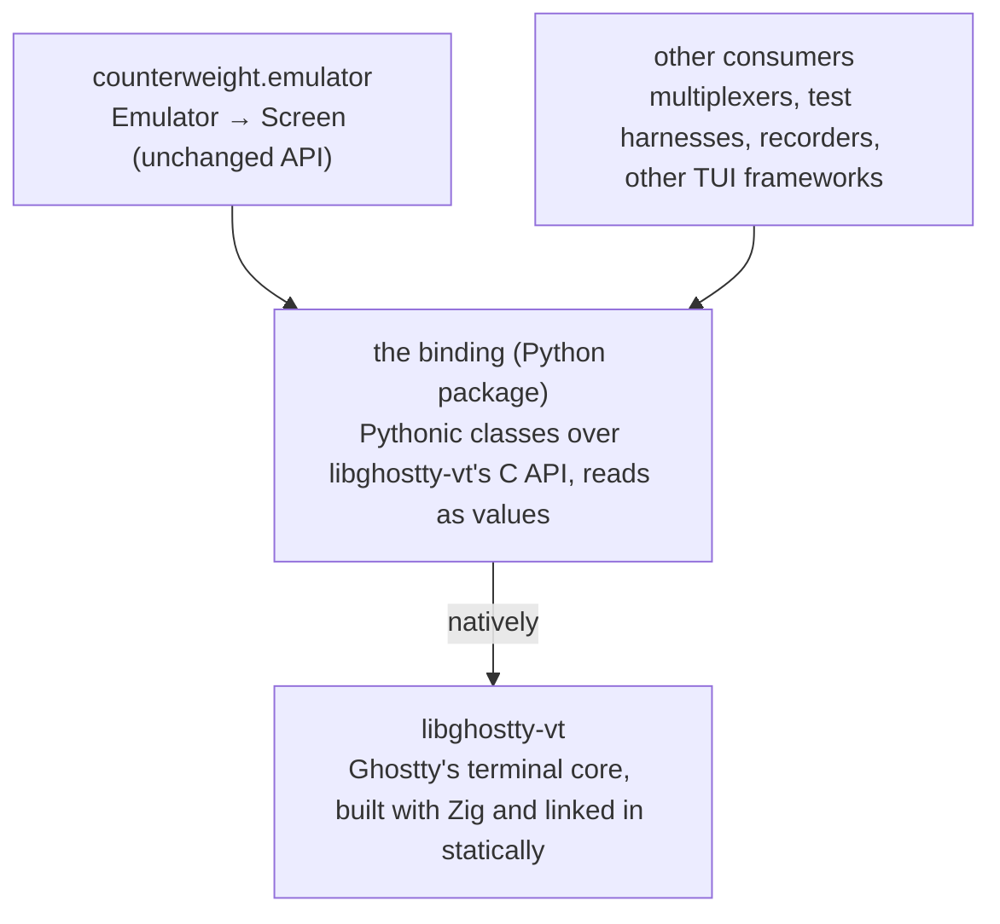

# Plan: An Owned Binding to libghostty-vt

Artifact: https://claude.ai/code/artifact/c9839b01-4bc0-47aa-ae63-955e2a783537

This plan replaces [pyghostty](https://github.com/AnswerDotAI/pyghostty), counterweight's binding to Ghostty's terminal emulator,
with a binding counterweight owns, as [waxy](https://github.com/JoshKarpel/waxy) is its binding to taffy.
It covers why, what the binding's API returns, which language it's written in, how it's built and released,
where it lives, and how `counterweight.emulator` moves onto it.
It doesn't change `Emulator` or `Screen`, the API the rest of counterweight and its users see,
and it doesn't cover the kitty keyboard protocol or anything else the emulator doesn't do today.

## Why own the binding?

Every cost below comes from the binding, not from libghostty-vt,
and fixing pyghostty upstream would cure only the first.

- **Making the first emulator takes about 190 ms.**
  pyghostty is cffi in in-line ABI mode: importing `pyghostty._ffi` parses its 3,500-line cdef with pycparser (about 94 ms),
  and each type string `Emulator.__init__` passes to `ffi.new` is parsed again on first use,
  after a `typedef` line for every typedef in the cdef (about 4 ms each, about 95 ms for its twenty).
  An inline app makes its emulator before its first frame, so every inline app starts that much later
  (see Run 29 in [the performance analysis](performance-analysis.md)),
  and every test subprocess that imports the emulator pays it too.
  The same cdef built out-of-line imports, loads the library and makes those types in 0.8 ms.
  Since the cost is architectural, an inline app keeps making its emulator unconditionally:
  once the binding loads in a millisecond or two, keeping it costs nothing worth an option.
- **Snapshots read cells through several cffi calls each.**
  `convert_row` reads a row's raw 64-bit cell values in one call, but reads a cell it hasn't seen
  through the cell iterator, since libghostty's header says the raw values' bit positions aren't ABI-stable,
  so they can't be decoded in Python.
  A screen that scrolls marks every row dirty, so a scroll converts the whole screen.
  Best times per snapshot of a 120×40 screen (`benchmarks snapshot`):

  | After | µs per snapshot |
  | --- | --- |
  | nothing | 66 |
  | a progress bar rewriting its row | 76 |
  | a plain line, scrolling | 435 |
  | a line of wide characters, scrolling | 515 |
  | a line with every word colored, scrolling | 3,638 |

- **Scrollback is captured in rounds to keep it affordable.**
  Capturing all 10,000 scrollback rows each snapshot cost 17 to 24 ms,
  so `update` asks for about as many rows as scrolled, doubling until it finds the last row it already has.
  That search, and the cache of rows it keeps by id, is a large share of `emulator.py`.
- **Raw pointers are counterweight's to get right.**
  A review found `convert_row` reading grapheme clusters into a fixed 32-slot buffer that libghostty overran:
  printing an `e` with 200 combining accents segfaulted the app.
  The buffer grows now, but nothing stops the next mistake of that kind.
- **counterweight reaches into pyghostty's internals.**
  It imports `pyghostty._ffi`'s `ffi`, `lib` and `check`, reads `Terminal._t` (with `# noqa: SLF001`),
  and makes 18 libghostty-vt calls itself; from pyghostty's public API it uses only `Terminal` and `init_sized`.
  So counterweight already is most of a binding, and depends on pyghostty for a built library and a cdef,
  through names pyghostty doesn't promise to keep.
  pyghostty has no type stubs, so none of those calls are type-checked.

## How does the web do it?

The web's embedded terminal is [xterm.js](https://xtermjs.org/), and its buffer API reads a cell at a time:
`buffer.getLine(y)` returns a line, `line.getCell(x, cell)` fills a cell object the caller passes back in
"to avoid costly recreation", and the cell has accessors like `getFgColorMode()` and `isFgRGB()`.
`translateToString()` reads a line's text in one call.

Python's own precedent is [pyte](https://github.com/selectel/pyte), and it reads values:
`screen.display` is each row's text, `screen.buffer[y][x]` is a `Char` named tuple of a cell's text, colors and attributes,
and `screen.dirty` is the set of rows that changed.

A JavaScript engine inlines xterm.js's small calls, so reading cell by cell is cheap there.
A call from Python into native code costs far more than the work it does,
so the binding's reads return values, as pyte's do, and its fast helpers read a whole row in one call.
Its low-level layer still reads a cell at a time, as xterm.js does, for code that wants one.

## The binding's API



The binding is a general Python API to libghostty-vt, and `Emulator` is one consumer of it.
It has two layers, as waxy does.

- **The low-level layer mirrors the C API**, as waxy's `TaffyTree` mirrors taffy's:
  one Python class for each of libghostty-vt's objects (a terminal, a render state, a row iterator, a key encoder),
  a method for each of its functions, enums for its constants, exceptions for its error codes,
  callbacks as Python callables, and reads that return immutable values.
  Anything libghostty-vt can do, a Python program can do through it, one call at a time.
- **Fast helpers do in one call what would be a loop over the low-level layer**, as waxy's `absolute_layouts(root)`
  returns every visible node with its absolute position, where Python would walk `children` and `layout` node by node.
  A helper exists where the loop's calls from Python would cost more than the work they do,
  and returns what the loop would have, so it's never the only way to get something.

```python
terminal = Terminal(columns=120, rows=40, scrollback_lines=10_000, on_write_pty=pty.write)
terminal.feed(output)
terminal.resize(columns=100, rows=30)

state = RenderState(terminal)
state.update()

# Low level: libghostty-vt's iterators, a call per row and per cell.
rows = state.row_iterator()
while rows.next():
    cells = rows.cells()
    while cells.next():
        cells.graphemes(), cells.style()

# A fast helper: every dirty row, each read in one native call, as values.
frame = state.frame()  # the cursor, colors, styles added since the last frame, and the rows
for row in frame.dirty_rows:
    row.graphemes, row.widths, row.styles

keys = KeyEncoder(terminal)  # encodes as the terminal's modes say
pty.write(keys.encode(Key.ENTER, mods=Mods.CTRL))
```

The first release covers what embedding a terminal needs:

| Area | libghostty-vt | Low level | Fast helpers |
| --- | --- | --- | --- |
| The terminal | `terminal.h`, `modes.h`, `device.h`: write, resize, reset, scroll the viewport, options and callbacks (replies to the program, title, working directory, clipboard, bell, unknown sequences) | `Terminal` | |
| Reading the screen | `render.h`, `screen.h`, `style.h`, `color.h`: render state, dirty rows with stable ids, cells, styles, the palette, overscan into the scrollback | `RenderState`, its row and cell iterators, `Style`, `Color` | `RenderState.frame()`, `RenderState.scrolled_off()` |
| Input to the program | `key/`, `mouse/`, `focus.h`, `paste.h`, `size_report.h`, `modes.h`, `color_scheme.h` encoders | `KeyEncoder`, `MouseEncoder`, `encode_focus`, `encode_paste`, ... | |
| Text out | `formatter.h`: the terminal's contents as plain text or VT | `Formatter` | |
| Widths | `unicode.h`: a codepoint's and a grapheme's width, as libghostty measures them | `codepoint_width`, `grapheme_width` | |

Later releases cover the rest, each of which has its own object lifetimes and callbacks to design,
so each waits for its own design rather than a mirror rushed into the first release:
selection and its gestures (`selection.h`), search (`search.h`), tracked grid references (`grid_ref_tracked.h`),
saving and restoring a terminal (`snapshot.h`), the standalone OSC and SGR parsers,
and kitty graphics (`kitty_graphics.h`), which counterweight's [#441](https://github.com/JoshKarpel/counterweight/issues/441) wants.

**The screen helpers are what replaces `emulator.py`'s cffi loops:**

- **`frame()` returns `Row` values, and an unchanged row is the same object.**
  The binding keeps each row it read by libghostty's row id while the row isn't dirty,
  and hands back the same `Row` for it, so a consumer that keeps derived data by row
  (`Emulator` shares unchanged rows by identity) skips them for free.
- **A row's cells come back as parallel sequences**, its grapheme clusters as `str`s, their widths, and their style indices,
  so a row of 120 cells is a handful of objects, not 120.
- **Styles are indices into the terminal's style table**, with each frame carrying the styles added since the last.
  libghostty's style ids mean something only within a page, so the helper interns styles itself, terminal-wide,
  and a consumer converts each style once, by index.
- **`scrolled_off()` returns the rows that scrolled into the scrollback since the last call**, captured natively,
  so the doubling search `emulator.py` does to keep capturing affordable moves into the binding.
- **libghostty allows one render state per terminal in effect**: a second takes the first's dirty flags.
  The binding documents it, as the C API does, rather than hiding it.

**What stays in counterweight** is what depends on counterweight: matching libghostty's columns to counterweight's own
`grapheme_width` (see "The screen painter" in [canvas-and-embedding](canvas-and-embedding.md)),
colors as `Color` and `IndexedColor`, and the swapped colors of inverse and invisible cells.
It runs once per changed row, as now.
Whether counterweight's `input_encoding` gives way to the binding's encoders is a separate decision, after this plan:
its pure functions are tested and work, and swapping them changes nothing this plan fixes.

## Which language?

The binding is native code either way; the question is what it's written in and what it builds Ghostty with.
Ghostty's `main` needs Zig 0.17.0 (`minimum_zig_version` in its `build.zig.zon`), so any of them builds Ghostty with Zig 0.17.

| | Rust: PyO3 and maturin | Zig: [ziggy-pydust](https://github.com/spiraldb/ziggy-pydust) | C helper: cffi API mode |
| --- | --- | --- | --- |
| Talks to Ghostty through | the C API, via [libghostty-rs](https://github.com/Uzaaft/libghostty-rs) | Ghostty's exported Zig modules (`vt`, `vt_c`), or its C API | the C API |
| Builds Ghostty | libghostty-rs's `build.rs`, at a pinned commit, statically | Ghostty as a Zig dependency, in the same build | Zig, separately, then links |
| Toolchains | Rust and Zig | Zig | a C compiler and Zig |
| Python packaging | maturin, as waxy | pydust's own, built around Poetry | setuptools |
| Precedent here | waxy: its build, release workflow, stubs and habits | none | none |
| Status | PyO3 is widely used; libghostty-rs has had 5 releases since March 2026 (0.2.2 in September), about 178,000 downloads, and two main contributors | 0.26.0 in September 2025, the last commit not from a bot in February 2026; supports Zig 0.14 (README) or 0.15 (`pyproject.toml` on `main`) | cffi is mature; the helper is ours to write |

**ziggy-pydust is the closest fit in principle.**
It shares Ghostty's language, so the binding could import Ghostty's Zig API directly, with no C ABI between them and no bindgen,
and needs one toolchain instead of two.
Ghostty exports those modules for downstream use (`src/build/GhosttyZig.zig`), and supports being built as a dependency.

**Today it doesn't fit, because of Zig's version.**
Zig doesn't keep source compatibility between minor releases, Ghostty needs 0.17, and pydust supports 0.15 at newest,
with its last release a year old.
Building the two in one Zig build means porting pydust to 0.17 first, and keeping it ported as Ghostty moves on:
in practice, maintaining a fork of pydust as well as the binding.
Building Ghostty separately with 0.17 and pydust with 0.15 works over the C ABI, but gives up the Zig API, which was the reason to choose it.
Ghostty's Zig API is also less stable than its C API, which Ghostty checks against an ABI type manifest (`test-lib-vt-schema`),
so binding to it would tie the binding to Ghostty's internal churn.

**Recommendation: Rust, on libghostty-rs's `libghostty-vt` crate.**
It's waxy's toolchain and release flow, and most of what a general binding needs already exists in Rust:

| libghostty-rs | What it is | Lines |
| --- | --- | --- |
| `libghostty-vt` | A safe Rust API over every area of the C API, its ownership and lifetimes worked out, encapsulating 593 uses of `unsafe`, with 117 unit tests and integration tests of lifetimes and allocators | 19,690 |
| `libghostty-vt-sys` | `build.rs`: clone Ghostty at a pinned commit, `zig build`, pkg-config, Windows and Apple specifics | 582 |
| | the bindgen script, and the bindings it generates | 181, 5,712 |

The build logic alone wouldn't be worth a dependency; the binding could carry its own in about 800 lines.
The safe API is what's worth it: the binding's low layer becomes PyO3 classes over safe Rust types,
with no `unsafe` of its own, so raw pointer mistakes like `convert_row`'s overrun can't happen in it,
and a fast helper's loop runs over the same safe types, at native speed.
It already exposes what the screen helpers need: overscan, `next_dirty`, a row's `id`, `dirty` and `viewport_y`,
`cells_raw`, and a cell's `style` and `graphemes`.
What this costs: two toolchains to build the binding (Rust and Zig 0.17),
dependence on libghostty-rs's cadence for new Ghostty commits and for wrapping new C APIs
(or overriding its source with `GHOSTTY_SOURCE_DIR`, and calling `libghostty-vt-sys` directly for what isn't wrapped yet),
and an `sdist` that needs network access, since its `build.rs` clones Ghostty.
Revisit pydust if it supports Ghostty's Zig version; the binding's Python API wouldn't change.

## How is it built and released?

- **Wheels** for manylinux (x86_64, aarch64), macOS (arm64, x86_64) and Windows (x86_64),
  from `PyO3/maturin-action`, as waxy's are.
  counterweight runs only on Linux and macOS (it uses `pty` and `termios`), but the binding only feeds bytes
  and reads the screen, so it's useful on Windows too, as waxy is.
  libghostty-rs builds and tests `libghostty-vt` for Windows x86_64 (MSVC and GNU) in CI on every push to `master`,
  so Windows costs one more build target. Windows on ARM waits until libghostty-rs tests it.
- **One wheel per platform, if the limited API is fast enough.**
  PyO3's `abi3` feature builds one wheel for every Python from the oldest it names;
  waxy instead builds one per Python version.
  The limited API can be slower for some operations, so the spike measures a snapshot both ways before choosing.
- **Zig 0.17 wherever the binding is built**, from the `ziglang` package on PyPI (0.17.0 was released on 2026-10-08) or from mise,
  passed to libghostty-rs through its `ZIG` variable.
  The binding has no Zig of its own and no Ghostty build logic, but `libghostty-vt-sys` has no prebuilt library:
  its `build.rs` clones Ghostty at its pinned commit and runs `zig build` (or builds a local checkout named by `GHOSTTY_SOURCE_DIR`).
  Its opt-in `pkg-config` feature links an installed libghostty-vt instead, which a wheel can't rely on.
  So Zig is needed by the CI that builds wheels and by whoever works on the binding,
  not by anyone who installs a wheel, and not by counterweight's contributors.
- **Pinned and locked**: `Cargo.lock` pins libghostty-rs, whose `build.rs` pins Ghostty's commit,
  and the usual cooldown applies to both.
- **Type stubs** ship with the package, checked against the module, as waxy's are.

## Where does it live?

In its own repository, as waxy is, released on its own schedule,
so counterweight's contributors and CI stay pure Python: nothing they run builds Rust or Ghostty.
What that costs: a change that needs a new libghostty-vt feature is two pull requests,
with a release of the binding between them.

## Work

1. **Spike** (decides the open questions below):
   a PyO3 module on `libghostty-vt` with `Terminal.feed` and a bulk `snapshot`, built on Linux, macOS and Windows.
   Measure import plus the first terminal (target: a few milliseconds, against 190 ms),
   `benchmarks snapshot`'s scenarios against today's,
   `abi3` against a per-version build, and how long a clean build of Ghostty takes in CI.
   Check whether pydust supports Zig 0.17 by then.
2. **The binding**, in its own repository: the first release's areas (see [The binding's API](#the-bindings-api)),
   tests of its own, stubs, docs, and a release workflow.
3. **`counterweight.emulator` on the binding**, behind the same `Emulator` and `Screen`:
   `tests/test_emulator.py` is the contract, unchanged.
   Delete the cffi code, the row and cell caches the binding replaces, and the overscan search.
   Run `benchmarks snapshot` against today's numbers, the inline workloads for startup,
   and a mutation testing pass over the new `emulator.py`.
4. **Drop pyghostty**: remove the dependency, and update `CLAUDE.md`'s Key Dependencies,
   `emulator.py`'s module docstring, and the emulator notes in [canvas-and-embedding](canvas-and-embedding.md).

## Open decisions

- **Language**: Rust (recommended) or Zig with pydust, settled by the spike.
- **Name**: the package's name on PyPI.

## Risks

- **libghostty-vt's C API is pre-1.0**, so new Ghostty commits can change it; the pin is what contains that.
- **libghostty-rs has two main contributors.** It's licensed MIT or Apache-2.0, so if it stalls, the binding can fork it
  and keep it current with Ghostty's C API itself: about 20,000 lines to own, so the risk is work, not a dead end.
- **Ghostty's build time in CI is unmeasured**; the spike measures it.
