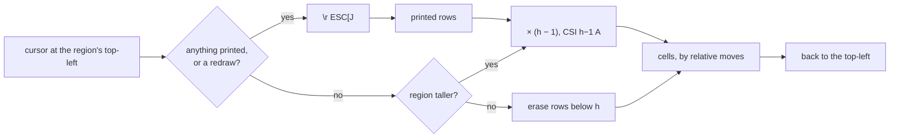

# Plan: Rendering Inline, below the Prompt

Artifact: https://claude.ai/code/artifact/f5e8d745-bc70-4c1e-8699-c91378a155cb

This plan implements [#393](https://github.com/JoshKarpel/counterweight/issues/393):
an app that renders into a region at the bottom of the terminal instead of taking over the alternate screen,
writes finished output above that region into the scrollback, where it stays after the app exits,
and leaves its last frame in place when it quits.
It's what a dev loop like [synth](https://www.synth.how/) needs (each process's log lines scroll up
over a status bar that stays at the bottom), and what an inline picker or a test runner's live status needs.
It doesn't cover starting below a prompt that didn't end its line (see [Deferred](#deferred)).

## The question

How does an app draw a live region of content-sized height below the shell prompt,
put finished output above it once, where the app never touches it again,
and keep both readable through resizes that make the terminal rewrap everything already on screen,
without knowing which row of the screen the region starts on?

## What synth does today

synth renders with `rich.Live` and prints each log line above it with `console.print`
([`renderer.py`](https://github.com/JoshKarpel/synthesize/blob/d4d24a893df1da2d5b5511b062f10102ca8eb973/src/synthesize/renderer.py)).
We ran it on a pseudo-terminal at 80×24 under five lines of fake shell history,
with three nodes that print on timers, and fed what it wrote into counterweight's `Emulator`.
Mid-run, the screen reads:

```text
  5|$ synth run
  6|05:26:39 fast   fast started (pid 2731424)
  7|05:26:39 fast   fast line 1 with some longer text to show how wrapping behaves
  8|                in narrow terminals
  9|05:26:39 slow   slow started (pid 2731427)
 10|05:26:39 slow   slow line 1
 ...
 15|────────────────────────────────────────────────────────────────────────────────
 16|05:26:40 Running fast slow  Pending after
```

Each log line is a `Table.grid` of a colored, fixed-width prefix and a body that wraps with a hanging indent,
so what's printed above the region is laid out, not just text.
The region is a rule and a status row. On exit, synth replaces it with a summary and the prompt comes back below:

```text
 20|────────────────────────────────────────────────────────────────────────────────
 21|Finished in 2.435 seconds. Final state:
 22|Succeeded after fast slow
 23|$
```

Every update, `Live` parks the cursor at the end of the region's last row, erases the region bottom-up
(`\r ESC[2K`, then `ESC[1A ESC[2K` for each row above), prints any new lines where it was, and redraws the whole region.
It never diffs, and doesn't use synchronized output.

Narrowing the terminal from 80 to 50 columns mid-run shows the hard part.
The terminal rewraps every row already on screen, the region's included, before the app hears about the resize:

```text
 13|05:27:14 fast   fast line 3 with some longer text
 14|to show how wrapping behaves
 15|                in narrow terminals
 16|
 17|──────────────────────────────────────────────────
 18|05:27:15 slow   slow line 2
```

Two things went wrong. Rich pads every row it prints to the full width with spaces,
so each padded row rewraps into an extra, blank one (row 16).
And the region's 80-column rule rewrapped onto two rows, but `Live` erased only the two rows it thought the region had,
so the rule's first 50 columns are left in the scrollback for good (row 17).
The lines synth prints after the resize wrap at 50 columns as they should.

## How the web does it

A full-screen app is a page whose shell is the viewport, `height: 100vh` with `overflow: hidden`;
an inline app is a document in normal flow whose height is its content's,
with a footer held to the bottom of the viewport by `position: sticky; bottom: 0`, as a chat page holds its composer.
What's scrolled above the footer is still the document, live and editable.
The terminal's scrollback is where counterweight differs: it's write-once.
Once a row scrolls above the region, the app can't change it, so it's printed exactly once, when it's finished.

React's answer for rendering once is [`renderToStaticMarkup`](https://react.dev/reference/react-dom/server/renderToStaticMarkup):
it runs a tree once, with each hook's initial state, and never starts its effects.
That's what printing a tree above the region does.
[Ink](https://github.com/vadimdemedes/ink), React for the terminal, renders inline by default
and puts finished output above with `<Static>`, a component that renders only the items it hasn't rendered before.

## How other terminal libraries do it

Read in each library's source at the commits linked.

| | Where the region is | Taller than the terminal | Output above | Resize | Mouse |
| --- | --- | --- | --- | --- | --- |
| [Ink](https://github.com/vadimdemedes/ink/blob/26d2c3f83008142061c22267482489588cc3823c/src/log-update.ts#L60-L110) 8 | Relative: erases the last frame's line count upward | Erases down from the top of the screen and writes everything | `<Static>`, rendered once, written above | Erases the old line count, which leaves rewrapped rows behind ([ink#907](https://github.com/vadimdemedes/ink/issues/907), closed as not planned) | None |
| [Textual](https://github.com/Textualize/textual/blob/5e5b7ef58b8c5572c13a3ff9027d756623661495/src/textual/drivers/linux_inline_driver.py) 8.2 | Relative, plus `CSI 6 n` after every frame | Clipped to the terminal's height | None | `CSI 2J`: erases the whole screen, shell output included | On, offset by the last cursor report |
| [Ratatui](https://github.com/ratatui/ratatui/blob/f57b06ffb72085644b35e71d296fd90b777dc073/ratatui-core/src/terminal/inline.rs#L393-L426) (master) | Absolute, from `CSI 6 n` at start and on resize | Fixed height | `insert_before`, by scrolling or scroll regions | Re-asks, then erases from the region's top down | Up to the app, already in screen coordinates |
| [Bubble Tea](https://github.com/charmbracelet/bubbletea/blob/f9df43c4f2c021d8740a2628d59cd810a862eb98/cursed_renderer.go) v2 | Relative; moves down by newlines, so it scrolls | Drops lines from the top | `Println`, written above | Erases from the region's top down, then redraws | Not offset |
| [`rich.Live`](https://github.com/Textualize/rich/blob/9d8f9a372cc5916fd4781fec207ced7ddac2f08f/rich/live.py) | Relative, from the end of the region's last row | `vertical_overflow`: ellipsis, crop or visible | `console.print` | Erases the old row count | None |

Two things carry over.
Only Ratatui knows the region's screen row, and only Ratatui and Textual pay a round trip to the terminal to find out.
Bubble Tea v2 and Ratatui both erase from the region's top down after a resize, which is the fix for synth's residue above,
and Bubble Tea gets there with relative moves alone.
Ratatui's released 0.30 erased the whole screen on narrowing instead, and master went back on that,
because it destroys what was printed above.

Ink and Bubble Tea leave the last frame in place on exit; Textual erases it unless `inline_no_clear` is set.
Textual turns synchronized output off inline, and Ink and Bubble Tea keep it on;
nothing we found says why Textual turns it off.

## Design

### Viewports

`app` takes a `viewport`, one of two values, and each holds only the options that make sense for it:

```python
@dataclass(frozen=True, slots=True)
class FullScreen:
    mouse: bool = True


@dataclass(frozen=True, slots=True)
class Inline:
    keep_last_frame: bool = True
    mouse: bool = False  # added in step 5


async def app(root: Component, ..., viewport: FullScreen | Inline = FullScreen()) -> None: ...
```

`FullScreen()` is what `app` does today. Its `mouse` turns mouse tracking off for an app that wants
the terminal's own selection and wheel instead, which costs nothing to offer once `Inline` needs the switch.
`Inline` turns mouse tracking off by default, because tracking captures the wheel,
and the wheel is how a user scrolls back through what an inline app printed.
Ink and `rich.Live` don't support the mouse at all; Textual turns it on inline.
`keep_last_frame=False` erases the region on exit, for a picker whose result belongs on the next line rather than in its frame.

Both live in `counterweight`, beside `app`, and `Still` and `Demo` take a `viewport` too.
Ratatui's `Viewport::Fullscreen | Inline(height)` is the model for the name.
A fixed-height inline region is a root with a fixed `height`, so `Inline` doesn't take one.

### The region

The app places the root in a screen element as wide as the terminal and as tall as the root's content,
at most the terminal's height: an auto grid row with `max_size_height`, where `FullScreen` uses a fixed one.
A root taller than that is clipped at the bottom like any other overflow.
A log that should show its newest lines keeps them in a `scroll_area` that sticks to the end.
Ink instead erases from the top of the screen and writes the whole frame again whenever it outgrows the terminal.

`LayoutTree.compute` takes the height as `int | None`.
With `None`, it lays the tree out with a max-content height and clips to the root's height,
which is how both the region and printed output are laid out.
The paint, the `Frame` a `Screenshot` takes, and everything `use_rects` reports are the region's size and coordinates.

### Drawing without knowing where the region is

The app never learns which row of the screen the region starts on, and doesn't need to.
Between frames, it parks the cursor at the region's top-left,
and every frame moves relative to that: `CSI n B` and `CSI n A` for rows and `CSI n G` for columns,
where `FullScreen` moves with `CSI row ; col f`.
`paint_to_instructions` takes which of the two it moves by.

| When | What the frame writes, from the region's top-left |
| --- | --- |
| The first frame, a resize, a resume | `\r ESC[J` (erase from here down), then the region as it grows (below), then every row |
| The region grows to `h` rows | `\n` × (h − 1) then `CSI h−1 A`, which scrolls the terminal up if the region reaches the bottom, then the cells that changed |
| The region shrinks to `h` rows | `CSI h B ESC[J CSI h A`, then the cells that changed |
| Output is printed | `\r ESC[J`, the printed rows, each followed by `\r\n`, then the region as for the first frame |
| Exit, keeping the last frame | `\n` × h then `\r`: the cursor on the row below the region, scrolling if it has to |
| Exit, `keep_last_frame=False` | `\r ESC[J` |

A move by 0 rows is left out rather than written, since `CSI 0 A` moves one row, as `CSI 1 A` does.
Everything below the region is blank, since every frame that shrinks it erases what it left, so a frame that grows it
diffs against the previous paint with blank rows added rather than drawing it all again.
Each frame stays one synchronized update, so nothing half-drawn shows, even when it prints and scrolls.

Parking at the top-left is what fixes synth's resize residue.
A terminal that rewraps keeps the cursor on the start of the region's first row,
so `\r ESC[J` erases the region however many rows the rewrap made of it, and the redraw starts in the right place.
We checked it in libghostty, narrowing 40 to 25 columns and widening 25 to 40, with the region mid-screen
and against the bottom of a full screen:

```text
===== resized to 25, before redraw (25x10) cursor=Position(x=0, y=5)
  3|committed: a line of fini
  4|shed output
  5|=========================
  6|===============
  7|status xxxxxxxxxxxxxxxxxx
  8|xxxxxxxxxxxxxxx
  9|last row
===== after CR + ESC[J + redraw at 25 (25x10) cursor=Position(x=0, y=5)
  3|committed: a line of fini
  4|shed output
  5|=========================
  6|status xxxxxxxxxxxxxxxxxx
  7|last row
```

The cursor stays on row 5, the region's first row, through the rewrap, and the redraw leaves nothing behind.
Rows written to the last column didn't rejoin when the terminal widened.
We haven't checked tmux, kitty, iTerm2 or VTE, and that's part of step 1.

What's already above the region rewraps as the terminal does it, which the app can't change.
Printed rows end at their last non-blank cell rather than being padded with spaces,
so narrowing doesn't turn them into synth's blank rows.

### Headless, and testing

A headless app writes nothing to a terminal, so today a test of it sees only what `Screenshot` captures,
and for an inline app that's the region alone: nothing it printed, and nothing of how a resize rewrapped it.
So a headless inline app writes each frame's instructions into an `Emulator` the size of `dimensions`, with scrollback,
where it throws them away today unless it's recording,
and `Screenshot`, and its `to_file`, take `include_scrollback`:

```python
@dataclass(frozen=True, slots=True)
class Screenshot(_Control):
    handler: Callable[[Frame], Awaitable[None] | None]
    include_scrollback: bool = False
```

Without it, the frame is the region, as `use_rects` sees it.
With it, the frame is everything the app's terminal holds, as a terminal shows it:
the rows scrolled off the top, then the screen, with what was printed above the region and the region below.
A full-screen app's alternate screen has no scrollback, so it's the same frame either way.
An inline app that isn't headless keeps the same emulator, fed what it writes to the terminal,
so a screenshot means the same thing whether the app is headless or not;
step 1 measures what feeding it costs a frame with `just profile` on a workload that prints, before settling that.

That's how a test of an inline app reads what it printed, with no pseudo-terminal:
an autopilot that drives the app, resizes it with `TerminalResized(dimensions=...)`,
and screenshots the whole terminal, asserting its `text(ansi=False)`.
It's how this plan's own tests check growing, shrinking, printing and rewrapping,
and how an inline example's still shows its printed lines above its region.
It comes first, in step 1, so every later step is tested through it.

### Printing above the region

`Print` is a control:

```python
@dataclass(frozen=True, slots=True)
class Print(_Control):
    content: Component | AnyElement
    stream: Literal["stdout", "stderr"] = "stdout"
```

In the frame after it arrives, the render loop renders `content` once, as `renderToStaticMarkup` does,
in a screen element as wide as the terminal and as tall as the content (it isn't capped, since it scrolls away),
then writes its rows above the region and draws the region below them.
Its components run once, with each hook's initial state; their effects never start,
and `use_rects` and `use_scroll` report nothing, since there's no previous frame.

### Standard output and standard error

`stream` picks which of the app's two streams the content goes to, as `print(file=sys.stderr)` does,
and `app` takes them as `stdout` and `stderr`, defaulting to `sys.stdout` and `sys.stderr`,
beside `output_stream`, the terminal it draws on.
A stream is the app's terminal when it's `output_stream` itself,
or a terminal device that's the same one as `output_stream`'s (the same `st_rdev`),
as both are when a program runs at a prompt with nothing redirected.
Content for the app's terminal goes above the region.
Content for any other stream is written to that stream as it is, where the region can't be disturbed by it:
with its styles if the stream is a terminal, and as plain text if it isn't,
laid out at its max-content width, since a file or a pipe has no width to wrap at.
Rich's `Console` drops styles the same way when it isn't writing to a terminal.

That's the picker's shape, as `fzf` has it:
`app(picker(), viewport=Inline(keep_last_frame=False), output_stream=sys.stderr)` draws on standard error,
and `Print(Text(content=chosen))` sends the choice down standard output to whatever reads it,
as in `cd "$(pick-a-directory)"`, or above the region when standard output is the terminal too.

A headless app's terminal is its emulator, so a stream that is `output_stream` goes there,
and any other is written to as it is, which is how a test reads standard output: it passes `stdout=io.StringIO()`.

Every `Print` that arrives in a cycle is written in that cycle's frame, in order,
beside the render that the same events caused.
So a handler or an effect that finishes an item prints it and drops it from the region's state in one frame:
the chat message that's done streaming, the test that passed, the step that finished.
That's synth's pattern: a log line is printed by the effect that reads it from the process,
and never lives in any state.

On a `FullScreen` app the main screen isn't showing, so what's printed is written when the app hands it back,
on exit or on suspend, at the width the terminal has then.
That keeps `Print` meaningful wherever a component runs, and lets a full-screen app leave a summary behind;
the cost is that it holds everything printed until then.

### Quitting

`Quit` currently stops the app at the top of the next cycle, before the state its handlers set is rendered.
That's invisible in the alternate screen, but an inline app's last frame stays in the scrollback,
so the app renders once more before it stops, without starting effects,
and the frame left behind shows what the last handlers set: the picked item, the final test summary.
It does the same for `FullScreen`, where only a recording shows the difference.

### Suspending

An inline app suspends by erasing its region, so the program it hands the terminal to starts where the region was,
and its output stays in the scrollback.
On resume, the region starts wherever that program left the cursor.

### Recording

A recording's header gets the terminal's size, and its preamble is what the viewport writes on start:
`OUTPUT_CONTROL_START` for `FullScreen`, and the cursor and title for `Inline`, with no alternate screen or clear.
The player then shows printed output scrolling up over the region.

### Capturing `print` and stderr

A stray `print`, or a warning on stderr, written while an inline region is on screen lands in the middle of it.
Ink ([`patchConsole`](https://github.com/vadimdemedes/ink#patchconsole), on by default)
and `rich.Live` (`redirect_stdout` and `redirect_stderr`, on by default) both catch it and print it above instead.
While an app that isn't headless runs, `sys.stdout` and `sys.stderr` are replaced with streams that turn each line
written to them into a `Print` of its text to the matching stream, from any thread.
A full-screen app gets the same, written when it hands the screen back, rather than garbling the alternate screen.
`app(capture_output=False)` turns it off.
It doesn't catch a subprocess writing to the terminal's file descriptor directly; neither do Ink or Rich.

### Mouse inline

Mouse reports are in screen coordinates, so an inline app that tracks the mouse has to know where its region is.
With `Inline(mouse=True)`, the app asks with a cursor position report (`CSI 6 n`) when it starts and after each resize,
and works out the region's top in between, since it knows the terminal's height and each frame's:
after a frame that prints `k` rows and draws `h`, the top is `min(top + k, rows − h)`.
That's a pure function, tested on its own.
Mouse events above the region are over the scrollback, not the app, so they're dropped.

A report is `CSI row ; col R`, which a modified F3 also is: Ctrl+F3 is `CSI 1 ; 5 R`.
Textual reads every one as a report, so Ctrl+F3 moves its mouse offset, and crossterm swallows them.
Bubble Tea v2's decoder emits both a key and a report for an ambiguous one,
and points to `CSI ? 6 n` (DECXCPR), whose reply `CSI ? row ; col R` can't be mistaken,
but libghostty doesn't answer `CSI ? 6 n` at all, so it can't be the only way to ask.
Counterweight asks only while the cursor is parked at column 0, so its reply is always `CSI row ; 1 R`,
and a modified F3's second number, its modifier, is always at least 2.
The parser reads `CSI row ; 1 R` as a report and everything else ending in `R` as F3, as it does now.

### Frame write order



## Steps

1. **Viewports, the inline region, and testing it headless.** `FullScreen`, `Inline` (without `mouse`),
   `app(viewport=...)`, the screen element per viewport, `LayoutTree.compute` with a `None` height,
   relative cursor moves in `paint_to_instructions`,
   the frame instructions in the table above as pure functions of the previous and next heights,
   resize, suspend, the final render on quit, the recording preamble, and `Still` and `Demo` taking a viewport.
   The inline app's emulator and `Screenshot(include_scrollback=True)`, with its cost measured.
   Tests: the instruction builders on their own; headless apps under an autopilot that grow, shrink,
   resize narrower and wider, suspend, and exit both ways, asserting whole-terminal screenshots;
   a terminal test that a real inline app's output, fed to an `Emulator` below some fake shell history,
   matches what the headless one shows; and that `FullScreen(mouse=False)` writes no mouse modes.
   Exercise it by hand in tmux, and in kitty, iTerm2 and a VTE terminal if they're to hand, narrowing and widening.
2. **Printing.** `Print`, `app`'s `stdout` and `stderr`, rendering once at the terminal's width,
   writing above the region, trimming trailing blank cells, writing to a stream that isn't the terminal,
   and holding full-screen prints until the screen is handed back.
   Tests, headless through whole-terminal screenshots: a printed component's effect never starts;
   prints and the state change from one handler land in one frame;
   several prints in a cycle keep their order, across both streams;
   a print taller than the terminal reaches the scrollback whole;
   a print to a `StringIO` standard output is plain text at its max-content width;
   a full-screen print appears after exit and after suspend; a recording shows the printed rows.
   A terminal test that standard output on the same pseudo-terminal as `output_stream` counts as the terminal.
3. **Capturing output.** The `sys.stdout` and `sys.stderr` replacements, `capture_output`,
   partial lines held until their newline or the app stops, and writes from another thread.
   Tests: a `print` in a handler lands above the region, and one to `sys.stderr` goes to the app's `stderr`;
   a headless app captures nothing; the streams are restored when the app stops and while it's suspended.
4. **Docs and examples.** A page on inline apps beside `docs/app.md`,
   and three snippets, each with a still of its region and a cast of it running:
   a dev loop in synth's shape (several processes' lines printed with a prefix and a hanging indent, under a status bar),
   a picker that prints what was picked and erases itself, and a test run's live progress with failures printed above.
   A changelog entry.
5. **Mouse inline.** `Inline(mouse=...)`, the cursor position request and its reply in the input parser,
   tracking the region's top, translating mouse events and dropping those above the region.
   Tests: the region-top function across growing, printing and shrinking;
   parsing a reply beside a modified F3; and an app on a pseudo-terminal whose clicks land on the right element.

## Deferred

- **Starting below a prompt that didn't end its line.** The region starts at column 0 of the cursor's row,
  so it draws over the end of a line printed without a newline, as Ink and Bubble Tea do.
  A cursor position report would show the column, but every inline app would pay for asking,
  which step 5 only does for apps that track the mouse.
